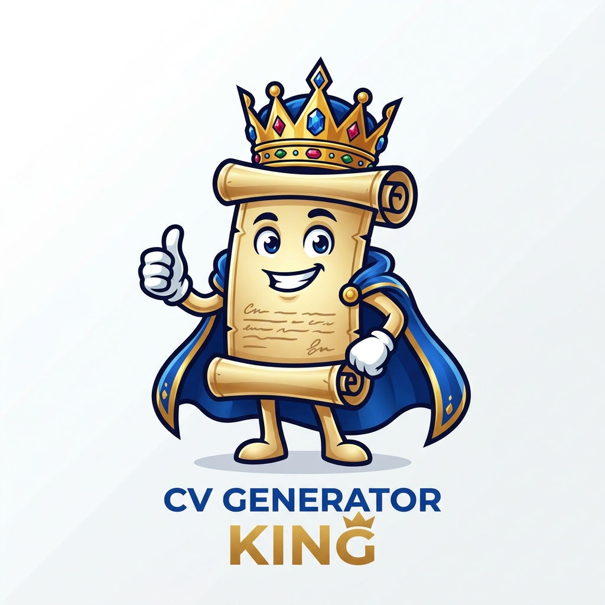

# 👑 CV Generator King

**CV Generator King** est une application web moderne de création, d'analyse et de modification intelligente de Curriculum Vitae, inspirée de [Jj's CV Generator](https://cv-generator-bice-beta.vercel.app/) et propulsée par une fonctionnalité inédite : **l'importation et la modification de CV existants par instructions en langage naturel tout en respectant le design original**.



---

## ✨ Fonctionnalités Royales

### 1. 🪄 L'Option Qui Change Tout : Importer & Modifier un CV Déjà Disponible
- **Import Multi-Formats** : Soumettez un CV existant au format **PDF (`.pdf`)**, **Word (`.docx`)**, **Image (`.jpg`, `.jpeg`, `.png`, `.webp`)**, **HTML (`.html`)**, **Texte/Markdown (`.txt`, `.md`)** ou **JSON (`.json`)**.
- **Analyse du Design Original ("Design DNA")** :
  - Détection automatique de la mise en page (`sidebar_left`, `sidebar_right`, `fancy_header`, `modern`, `classic`, `executive`).
  - Extraction automatique de la palette de couleurs exacte (couleur primaire, couleur d'accentuation, couleur d'arrière-plan de la colonne latérale et de l'en-tête).
  - **Double Mode de Fidélité** :
    1. **Design Reconstruit (Smart Clone)** : Reconstruit la structure et les couleurs du CV original avec 100% des sections éditables.
    2. **Calque Original Pixel-Perfect (100%)** : Affiche le rendu haute définition exact du PDF ou de l'image d'origine et superpose des blocs de texte interactifs aux coordonnées exactes permettant d'éditer ou de remplacer n'importe quel texte par simple clic ou par instruction !
- **Modification par Instructions en Langage Naturel** :
  - Fonctionne **immédiatement sans clé API** grâce au moteur hybride local intégré, et supporte également les clés API **Google Gemini**, **OpenAI (GPT-4o)** et **Groq (Llama 3.3)**.
  - Exemples d'instructions comprises :
    - *"Ajoute une expérience de Lead Dev chez Google de 2024 à Présent : direction d'une équipe de 6 ingénieurs"*
    - *"Ajoute les compétences Docker, Kubernetes, AWS et GraphQL"*
    - *"Change mon titre en Architecte Cloud & IA Senior"*
    - *"Remplace '2022' par '2025'"*
    - *"Optimise mon profil professionnel pour l'ATS"*
    - *"Traduis tout le CV en anglais"*

### 2. 📦 Export Universel — Tous Formats Supportés
- **PDF Haute Qualité (`.pdf`)** : Format A4 vectoriel/haute densité prêt pour l'impression et les recruteurs.
- **Microsoft Word (`.docx`)** : Vrai document Word natif éditable respectant les couleurs et sections.
- **JPEG Haute Résolution (`.jpg`)** : Rendu 300 DPI.
- **PNG Sans Perte (`.png`)** & **WebP (`.webp`)**.
- **SVG Vectoriel (`.svg`)** : Pour la retouche ou l'impression grand format.
- **Page Web HTML5 Autonome (`.html`)** : Prête à être hébergée en portfolio.
- **Markdown (`.md`)** & **Texte Brut ATS (`.txt`)**.
- **Sauvegarde Projet (`.json`)**.

### 3. 🏆 Pack Royal Complet Intégré
- **9 Templates Personnalisables** : *Design Original Importé*, *Sidebar Gauche*, *Moderne*, *Élégant (Bandeau)*, *Sidebar Droite*, *Exécutif Royal*, *Classique ATS*, *Créatif Studio*, *Minimaliste*.
- **Analyseur ATS (/100) & Comparateur d'Offre d'Emploi (Job Matcher)** : Calcule votre score ATS sur 8 critères clés, compare votre CV à une offre d'emploi collée et injecte les mots-clés manquants en 1 clic.
- **Générateur de Lettre de Motivation Assortie** : Génère et met en page une lettre de motivation reprenant automatiquement le design et les couleurs de votre CV.
- **Traduction Instantanée en 1 Clic** : Français (`FR`), Anglais (`EN`), Espagnol (`ES`), Allemand (`DE`).
- **QR Code Dynamique Intégré** & **Gestionnaire Multi-Versions (avec Undo / Redo)**.

---

## 🚀 Installation & Démarrage Local

```bash
cd cv-generator-king
npm install
npm run dev
```

Pour compiler la version de production (prête pour **Vercel** / **GitHub Pages** / **Netlify**) :

```bash
npm run build
```

---

## 🐙 Pousser sur GitHub

Le dépôt Git est déjà initialisé et proprement configuré avec son `.gitignore` :

```bash
cd /home/roserick/cv-generator-king
git remote add origin https://github.com/<votre-utilisateur>/cv-generator-king.git
git branch -M main
git push -u origin main
```
